# 1. Introducción, alcance y estado del proyecto

El objetivo del proyecto fue construir un pipeline completo de DevOps: una aplicación contenerizada, infraestructura definida como código, integración y despliegue continuos, ejecución en Kubernetes con auto-escalado, observabilidad con Prometheus y Grafana, análisis de seguridad estático y dinámico (SAST y DAST) y medidas de optimización de costos (FinOps).

**Repositorio (público):** <https://github.com/Hernan96HMM/coderhouse-devops>

Como no se contaba con una aplicación previa ni con una nube definida, se tomaron las siguientes decisiones:

| Decisión | Elección | Motivo |
|---|---|---|
| Aplicación | API REST en Node.js (Express) | Simple, con tests y métricas Prometheus |
| Nube objetivo | AWS (VPC + EKS) | Kubernetes gestionado, amplia documentación |
| CI/CD | GitHub Actions | Integrado al repositorio; permite OIDC hacia AWS |
| Registry | GitHub Container Registry (GHCR) | Gratuito y sin credenciales adicionales |
| IaC | Terraform con módulos propios | Reutilizable y parametrizable por entorno |
| Entorno de pruebas | kind (Kubernetes en Docker) | Permite validar el despliegue sin costo de nube |
| Monitoreo | kube-prometheus-stack (Helm) | Prometheus, Grafana y exporters en un solo chart |
| SAST / DAST | CodeQL, Trivy / OWASP ZAP | Cubren código, IaC, imagen y aplicación en ejecución |

## 1.1 Qué se ejecutó y qué no

Para dejar claro el alcance real de las evidencias de este informe:

| Componente | Estado | Evidencia |
|---|---|---|
| Aplicación, tests y Dockerfile multi-stage | Ejecutado | Secciones 3 y 4 |
| CI en GitHub Actions (test, SAST, escaneo de imagen, push a GHCR) | Ejecutado | Sección 6 |
| Despliegue en Kubernetes (Deployment, Service, Ingress, HPA) | Ejecutado en un cluster **kind** local | Secciones 7 y 8 |
| Auto-escalado (HPA) bajo carga | Ejecutado en kind | Sección 8 |
| Prometheus y Grafana | Ejecutado en kind | Sección 9 |
| SAST | Ejecutado en el CI | Sección 10.1 |
| DAST (OWASP ZAP), antes y después de corregir | Ejecutado contra la app en kind | Sección 10.2 |
| Terraform (VPC + EKS) y workflow de CD hacia EKS | **Definido pero no ejecutado** | Sección 5 |

El código de Terraform y los workflows `infra.yml`, `cd.yml` y `finops.yml` están en el repositorio y documentados, pero **no se aplicaron contra AWS** para evitar el costo por hora de EKS (control plane, NAT Gateway y nodos) en un trabajo de práctica. El despliegue en Kubernetes se validó en un cluster local con los mismos manifiestos que usaría el pipeline.

# 2. Arquitectura

```
git push -> GitHub Actions
  CI:    tests -> SAST (CodeQL, Trivy IaC) -> build -> Trivy imagen -> push a GHCR
  Infra: terraform fmt/validate/plan/apply (OIDC, sin claves largas)      [definido]
  CD:    helm (metrics-server, ingress-nginx, kube-prometheus-stack)
         -> kubectl apply -k k8s/base -> smoke test -> DAST (ZAP)         [definido]

Objetivo AWS: VPC (subnets públicas/privadas) -> EKS (node group spot)
              -> ingress-nginx -> Service -> Pods (HPA 2 a 8)
Entorno validado: kind -> ingress-nginx -> Service -> Pods (HPA 2 a 8)
Monitoreo: ServiceMonitor -> Prometheus -> Grafana
```

Estructura del repositorio:

| Ruta | Contenido |
|---|---|
| `app/` | API Express, tests y `Dockerfile` multi-stage |
| `terraform/` | Raíz con variables, módulos `network`, `cluster`, `finops`, tfvars por entorno y `bootstrap/` (estado remoto + OIDC) |
| `k8s/base/` | Namespace, Deployment, Service, Ingress, HPA, PodDisruptionBudget (Kustomize) |
| `k8s/overlays/local/` | Variante para cluster local con kind |
| `k8s/monitoring/` | Values de kube-prometheus-stack, ServiceMonitor, alertas y dashboard de Grafana |
| `.github/workflows/` | `ci.yml`, `infra.yml`, `cd.yml`, `finops.yml` |
| `docs/` | Este informe y las evidencias (`docs/evidencias/`) |

# 3. Aplicación

Se desarrolló una API con los endpoints `/` (información), `/health` (salud), `/api/sum` (lógica con validación de parámetros), `/api/load` (consumo de CPU controlado, usado para demostrar el HPA) y `/metrics` (formato Prometheus: contador de requests, histograma de latencia y métricas del proceso).

Cuenta con 6 tests automatizados con el runner nativo de Node (`node --test`), que cubren los endpoints, la validación de parámetros, la exposición de métricas y las cabeceras de seguridad. Implementa apagado ordenado ante `SIGTERM`, lo que permite a Kubernetes reemplazar pods sin cortar solicitudes.

# 4. Docker

El `Dockerfile` usa **multi-stage build** con tres etapas:

1. `deps`: instala solo las dependencias de producción.
2. `test`: instala todo y ejecuta los tests; si fallan, el build falla.
3. `runtime`: imagen final sobre `node:20-alpine` que contiene únicamente `node_modules` de producción y el código.

Optimizaciones y seguridad: imagen mínima, `.dockerignore`, aprovechamiento de caché de capas, usuario **no root con UID numérico 10001** (necesario para que Kubernetes pueda verificar `runAsNonRoot`), `HEALTHCHECK`, `NODE_ENV=production`, y eliminación de `npm`, `yarn` y `corepack` de la imagen final (la aplicación solo necesita el binario `node` para ejecutarse).

Fragmento de la salida de `docker build -t pf-devops-app:local ./app`, donde se observa que la etapa de tests se ejecuta y que la imagen final depende de ella:

```
[test 7/7] RUN npm test
[runtime 3/8] RUN --mount=type=bind,from=test,source=/app/package.json,target=/tmp/tests-passed true
[runtime 4/8] RUN rm -rf /usr/local/lib/node_modules /usr/local/bin/npm ...
[runtime 5/8] RUN addgroup -S -g 10001 app && adduser -S -u 10001 -G app app
[runtime 6/8] COPY --from=deps --chown=app:app /app/node_modules ./node_modules
```

# 5. Terraform (definido, no aplicado)

Estructura:

- `terraform/` (raíz): `versions.tf`, `backend.tf` (backend S3 con configuración parcial, para no fijar nombres de bucket en el repositorio), `variables.tf`, `main.tf` y `outputs.tf`.
- `modules/network`: VPC con subnets públicas y privadas, NAT Gateway (único o por zona) y etiquetas para balanceadores. Se apoya en `terraform-aws-modules/vpc`.
- `modules/cluster`: cluster EKS con node group administrado, capacidad spot u on-demand, tamaños mínimo/deseado/máximo y restricción de CIDR para el endpoint público. Se apoya en `terraform-aws-modules/eks`.
- `modules/finops`: apagado y encendido programado de nodos y presupuesto mensual con alertas.
- `envs/dev.tfvars` y `envs/prod.tfvars`: valores por entorno.
- `bootstrap/`: se ejecuta una sola vez y a mano; crea el bucket S3 versionado y cifrado, la tabla DynamoDB de bloqueo, el proveedor OIDC de GitHub y el rol IAM que asume el pipeline.

Se usan variables con validaciones (por ejemplo, `environment` solo admite `dev` o `prod`) y `default_tags` para etiquetar todos los recursos con `Project`, `Environment`, `ManagedBy` y `CostCenter`.

# 6. Pipeline CI/CD

## 6.1 Workflows

- **`ci.yml`**: se ejecuta en cada push y en lanzamientos manuales.
  - `test`: `npm ci`, tests y `npm audit` de dependencias de producción.
  - `sast`: CodeQL sobre el código y Trivy `config` sobre Terraform y manifiestos Kubernetes.
  - `image`: build con el Dockerfile multi-stage, escaneo Trivy de la imagen (falla ante vulnerabilidades críticas con corrección disponible) y push a GHCR con tags `<sha>` y `latest`.
- **`infra.yml`**: `fmt`, `init` con backend remoto, `validate`, `plan` y, a pedido, `apply` o `destroy`; autenticación por OIDC. *(Definido, no ejecutado.)*
- **`cd.yml`**: instala metrics-server, ingress-nginx y kube-prometheus-stack, fija la imagen con `kustomize edit set image`, aplica los manifiestos, espera el rollout, hace un smoke test y ejecuta OWASP ZAP. *(Definido, no ejecutado.)*
- **`finops.yml`**: encendido y apagado de los nodos del entorno de pruebas. *(Definido, no ejecutado.)*

## 6.2 Secretos y variables

| Tipo | Nombre | Uso |
|---|---|---|
| Secret | `AWS_ROLE_ARN` | Rol que asume el pipeline por OIDC |
| Secret | `GRAFANA_ADMIN_PASSWORD` | Contraseña de Grafana en el despliegue por CD |
| Variable | `AWS_REGION`, `TF_STATE_BUCKET`, `TF_LOCK_TABLE`, `CLUSTER_NAME` | Configuración no sensible |

Ninguna credencial figura en el repositorio. En el CI se usa únicamente el `GITHUB_TOKEN` provisto por GitHub para publicar en GHCR.

## 6.3 Evidencia de ejecución del CI

La ejecución **CI #7** completó los tres jobs con éxito en 2 minutos 7 segundos (`Build y test`: 9 s, `SAST`: 1 min 6 s, `Imagen Docker`: 54 s).

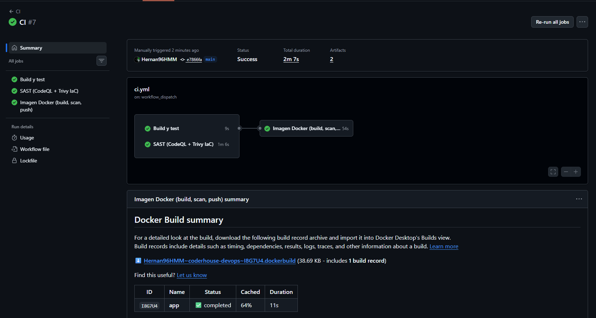{ width=16cm }

El job de imagen ejecuta, en orden: build local, escaneo Trivy de la imagen, login en GHCR y push.

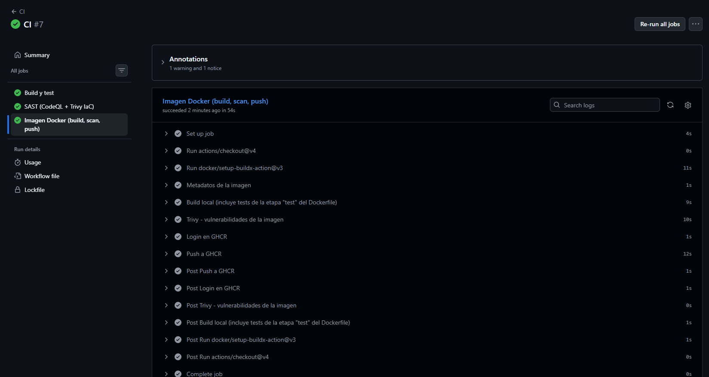{ width=16cm }

El job SAST ejecuta CodeQL (analizó 3 de 3 archivos JavaScript) y Trivy sobre Terraform y manifiestos.

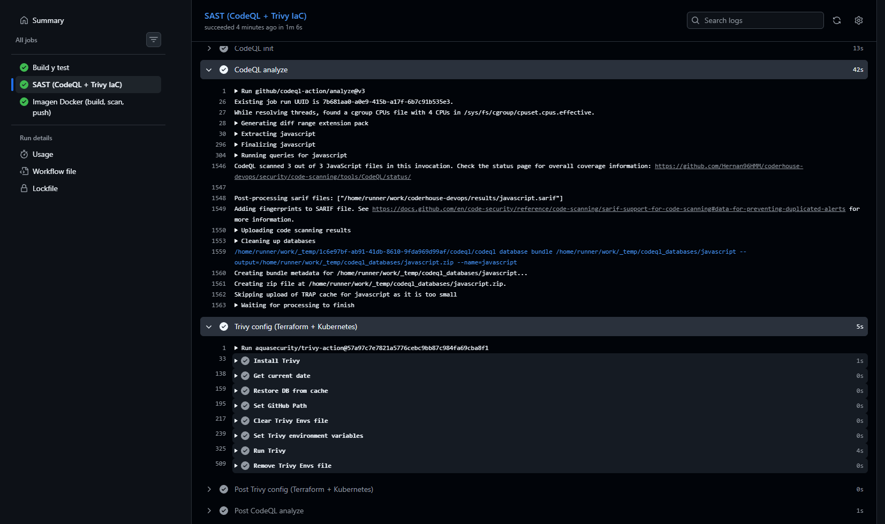{ width=16cm }

La imagen quedó publicada en GitHub Container Registry.

{ width=13cm }

# 7. Kubernetes

Manifiestos en `k8s/base` (gestionados con Kustomize):

- **Namespace** `pf-devops`.
- **Deployment**: 2 réplicas, estrategia `RollingUpdate` sin indisponibilidad (`maxUnavailable: 0`), probes de readiness y liveness sobre `/health`, requests y limits de CPU y memoria, y contexto de seguridad (no root, sistema de archivos de solo lectura, sin capabilities, perfil seccomp `RuntimeDefault`).
- **Service** `ClusterIP` en el puerto 80.
- **Ingress** con clase `nginx`.
- **HorizontalPodAutoscaler** (v2): entre 2 y 8 réplicas, objetivo de 60 % de CPU y 80 % de memoria, con escalado rápido hacia arriba y gradual hacia abajo.
- **PodDisruptionBudget** con `minAvailable: 1`.

## 7.1 Cluster de pruebas

El despliegue se validó en un cluster **kind** (nodo `kindest/node:v1.34.0`, con Ingress NGINX v1.15.1 y metrics-server). La imagen se construyó localmente y se cargó al cluster con `kind load docker-image`.

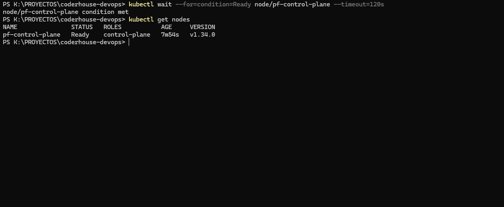{ width=13cm }

## 7.2 Recursos desplegados

Tras `kubectl apply -k k8s/overlays/local` el rollout se completó, la aplicación respondió `{"status":"ok"}` a través del Ingress en `localhost:8080` y el HPA obtuvo métricas reales (CPU 8 % sobre un objetivo de 60 %).

{ width=16cm }

# 8. Auto-escalado (HPA)

Para demostrar el HPA se generó carga CPU-intensiva desde dentro del cluster: tres pods `busybox` que invocan en bucle el endpoint `/api/load?ms=500`.

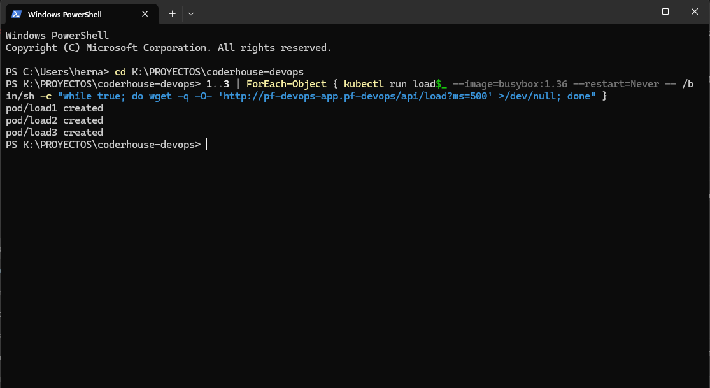{ width=13cm }

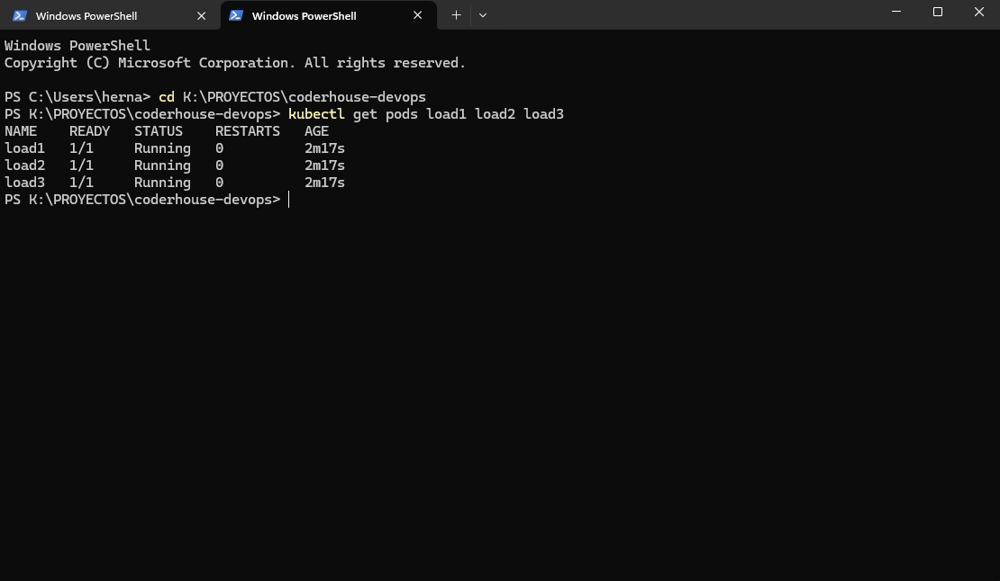{ width=12cm }

Con la carga activa, el HPA llevó el Deployment de 2 a **8 réplicas** (el máximo configurado):

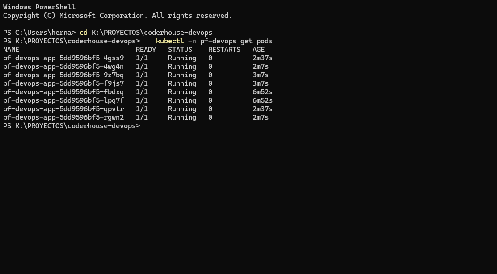{ width=13cm }

El detalle del HPA muestra la CPU en 163 % sobre un objetivo de 60 % y los eventos `SuccessfulRescale` en tres pasos (4, 6 y 8 réplicas, con el motivo *cpu resource utilization above target*). La condición `ScalingLimited: TooManyReplicas` confirma que se alcanzó el máximo. Las advertencias `FailedGetResourceMetric` del inicio son esperables: el metrics-server aún no tenía métricas de los pods recién creados.

{ width=16cm }

Al retirar la carga, el HPA devolvió el Deployment a 2 réplicas, con la CPU en 10 %. Esto es relevante para FinOps: la aplicación solo consume la capacidad que necesita.

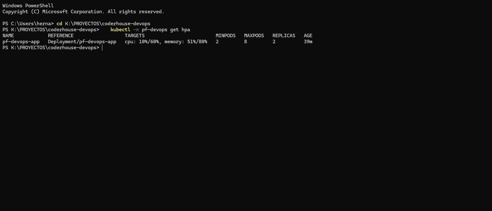{ width=16cm }

# 9. Monitoreo con Prometheus y Grafana

Se instaló `kube-prometheus-stack` con valores propios (`k8s/monitoring/kube-prometheus-stack-values.yaml`): retención de métricas de 3 días, Alertmanager deshabilitado para ahorrar recursos y límites de memoria ajustados. Un **ServiceMonitor** indica a Prometheus que recolecte `/metrics` de la aplicación cada 15 segundos. Además se definieron dos alertas (`AppDown` y `HighErrorRate`) como `PrometheusRule`.

En Prometheus, el target `serviceMonitor/pf-devops/pf-devops-app` figura con **8 de 8 endpoints en estado UP**, uno por cada pod escalado por el HPA.

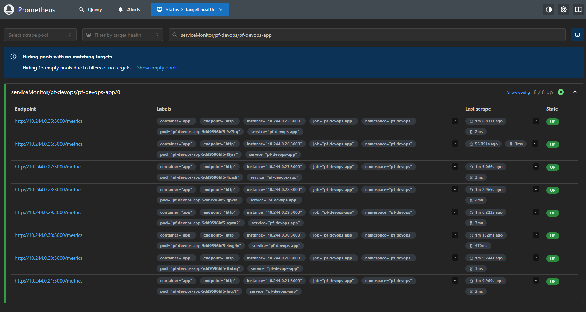{ width=16cm }

El dashboard de Grafana **«PF DevOps - Aplicación»** se provisiona por ConfigMap e incluye seis paneles: requests por segundo (por ruta), latencia p95, CPU por pod, memoria por pod, réplicas del HPA (actuales y deseadas) y errores 5xx. En la captura se aprecia el inicio de la carga (requests de `/api/load`), el aumento de la latencia p95 hasta cerca de 1 segundo, el reparto de CPU entre los 8 pods y la subida de las réplicas de 2 a 8. El panel de errores 5xx indica `No data` porque la aplicación no devolvió ningún error 5xx durante la prueba.

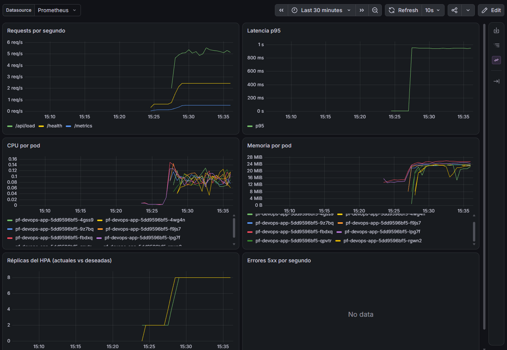{ width=15cm }

# 10. Seguridad

## 10.1 SAST y análisis de la cadena de suministro

| Control | Herramienta | Dónde | Resultado |
|---|---|---|---|
| Análisis estático del código | CodeQL | Job `sast` | 0 alertas |
| Misconfiguraciones de Terraform y Kubernetes | Trivy `config` | Job `sast` | Ejecutado (informativo) |
| Dependencias de producción | `npm audit` | Job `test` | Pasó tras actualizar `body-parser` |
| Vulnerabilidades de la imagen | Trivy `image` | Job `image` | Pasó tras quitar `npm` de la imagen final |

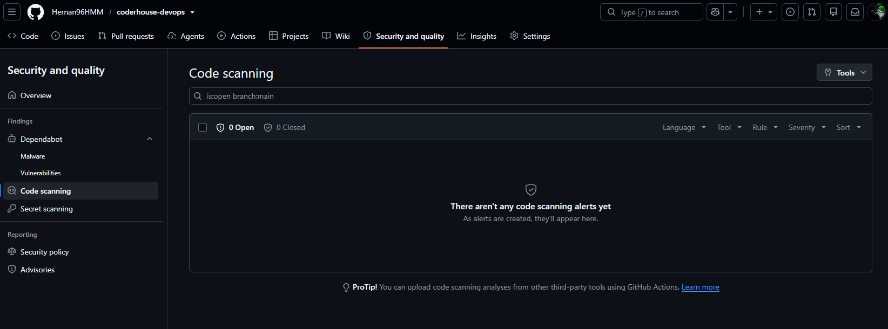{ width=16cm }

Otras medidas: autenticación a AWS por OIDC (sin claves de larga duración), secretos fuera del repositorio, contenedor no root con sistema de archivos de solo lectura y sin capabilities, y acciones de terceros fijadas por SHA de commit.

## 10.2 DAST con OWASP ZAP: hallazgos y corrección

Se ejecutó `zap-baseline.py` (ZAP 2.17.0) contra la aplicación desplegada en kind, a través del Ingress. El primer escaneo no encontró alertas altas, pero sí **3 advertencias** (1 media y 2 bajas):

| Hallazgo | Riesgo | Corrección aplicada |
|---|---|---|
| CSP: directivas sin *fallback* (`frame-ancestors`, `form-action`) | Medio | Política `Content-Security-Policy` completa en todas las respuestas y un handler 404 propio que evita la página de error por defecto de Express |
| Fuga de información por `X-Powered-By: Express` | Bajo | `app.disable('x-powered-by')` |
| Falta `X-Content-Type-Options` | Bajo | Cabecera `X-Content-Type-Options: nosniff` |

**Antes de la corrección** (3 advertencias nuevas):

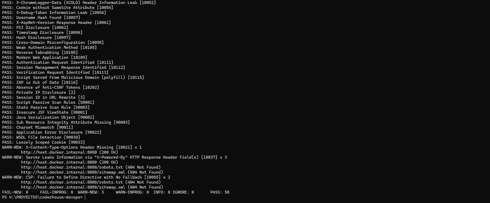{ width=16cm }

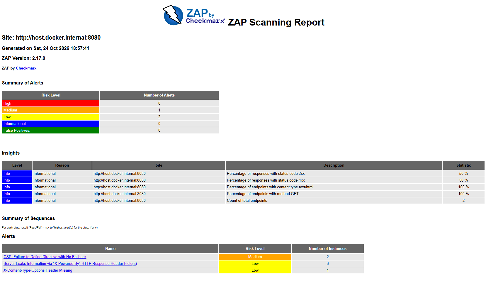{ width=16cm }

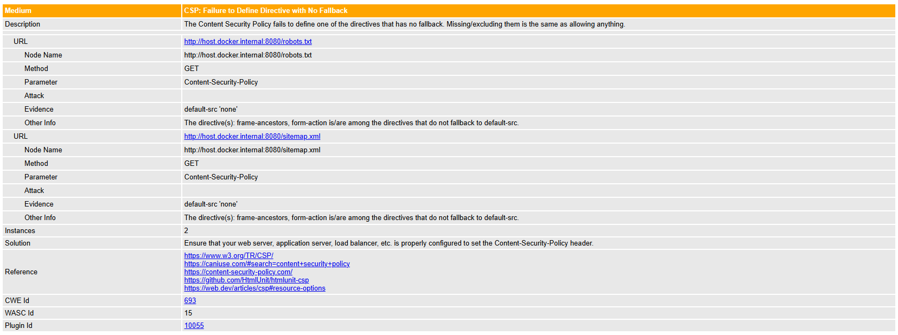{ width=16cm }

{ width=16cm }

{ width=16cm }

Las correcciones se acompañaron de dos tests automatizados nuevos (cabeceras de seguridad y respuesta 404), se reconstruyó la imagen, se reinició el Deployment y se repitió el escaneo.

**Después de la corrección** (0 alertas, 61 reglas aprobadas, incluida la de CSP):

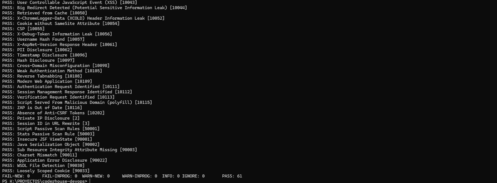{ width=16cm }

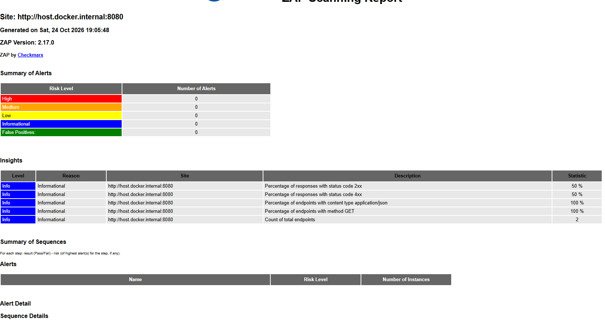{ width=16cm }

Una limitación a tener en cuenta: el modo *baseline* de ZAP es un análisis pasivo y la aplicación expone pocos endpoints, por lo que el resultado limpio no equivale a una auditoría completa.

# 11. FinOps

| Medida | Implementación | Estado |
|---|---|---|
| Nodos spot en desarrollo | `node_capacity_type = "SPOT"` | Definido |
| Un solo NAT Gateway en desarrollo | `single_nat_gateway = true` | Definido |
| Apagado nocturno de nodos | `aws_autoscaling_schedule` y workflow `finops.yml` | Definido |
| Auto-escalado de pods (2 a 8) | HPA | **Validado** (sección 8) |
| Requests y limits ajustados | Mejor aprovechamiento de los nodos | **Validado** |
| Retención corta de métricas, Alertmanager deshabilitado | `kube-prometheus-stack-values.yaml` | **Validado** |
| Etiquetado de costos | `default_tags` (`Project`, `Environment`, `CostCenter`) | Definido |
| Presupuesto mensual con alertas al 80 % y 100 % | Módulo `finops` | Definido |

No se estimaron costos en dólares porque dependen de los precios vigentes de AWS al momento de desplegar; el README del repositorio detalla qué recursos generan costo por hora y cómo destruir el entorno.

# 12. Problemas encontrados y cómo se resolvieron

El pipeline no funcionó a la primera; estos fueron los problemas reales y su resolución.

| # | Problema | Causa | Solución |
|---|---|---|---|
| 1 | El CI #1 falló a los 28 s | `npm audit` detectó una vulnerabilidad alta en `body-parser` (dependencia de Express) y el paso estaba configurado para cortar el pipeline. Se identificó reproduciendo el job localmente | `npm audit fix` actualizó `body-parser` a 1.20.9 |
| 2 | El job SAST falló: «unable to find version `0.28.0`» | El tag no existía (los tags de `trivy-action` llevan prefijo `v`). Además, en marzo de 2026 la acción sufrió un compromiso de cadena de suministro con tags reescritos | Se fijó la versión v0.35.0, indicada como segura por el aviso del fabricante, **por SHA de commit** |
| 3 | El escaneo de la imagen falló por una vulnerabilidad crítica (`tar` 6.2.1) | Estaba en el `npm` incluido en la imagen base de Node, no en la aplicación | Se eliminaron `npm`, `yarn` y `corepack` de la imagen final |
| 4 | La etapa `test` del Dockerfile no se ejecutaba | BuildKit omite las etapas de las que no depende la imagen final | Se agregó una dependencia explícita (`RUN --mount=type=bind,from=test ...`) |
| 5 | `kind create cluster` falló: el API server no arrancaba | Docker Desktop usaba **cgroup v1** (`docker info` devolvió `1`) y la versión de Kubernetes del nodo por defecto (v1.37) ya no lo soporta | Se fijó la imagen del nodo: `--image kindest/node:v1.34.0` |
| 6 | Grafana se reiniciaba (16 reinicios) y `helm --wait` agotó el tiempo | Límite de memoria de 256 Mi demasiado bajo | Se subió el límite a 512 Mi |
| 7 | Los paneles de Grafana mostraron «Error loading: timeseries» | Fallo de carga del componente de gráficos en el navegador, relacionado con la inestabilidad anterior de Grafana | Se resolvió con la estabilización del pod y recarga de la página |
| 8 | ZAP reportó 3 advertencias | Cabeceras de seguridad ausentes y página 404 por defecto | Ver sección 10.2 |
| 9 | Un `git push` fue rechazado | Se había subido un archivo desde la web de GitHub | `git pull --rebase` y eliminación del archivo duplicado |

{ width=14cm }

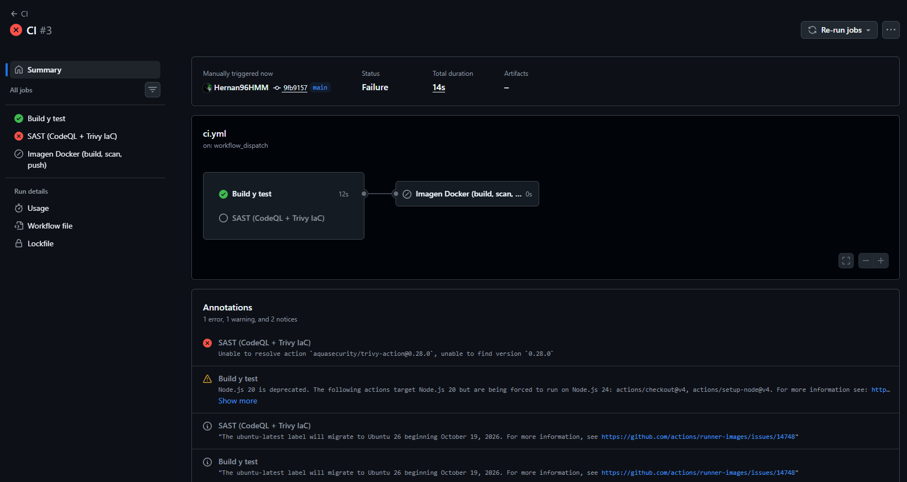{ width=16cm }

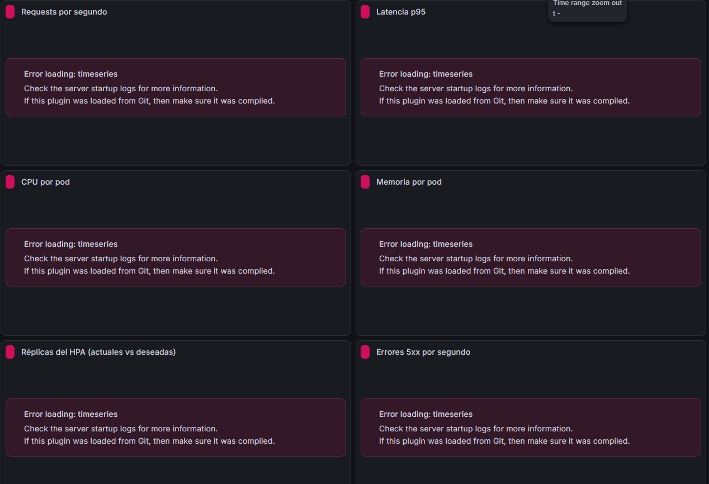{ width=12cm }

# 13. Cómo replicar y validar

Los pasos completos están en el `README.md` del repositorio. En resumen, para reproducir el entorno de pruebas sin costo (PowerShell en Windows con Docker Desktop, `kind`, `kubectl` y `helm`):

```
kind create cluster --name pf --config scripts/kind-config.yaml --image kindest/node:v1.34.0
docker build -t pf-devops-app:local ./app
kind load docker-image pf-devops-app:local --name pf
kubectl apply -f https://raw.githubusercontent.com/kubernetes/ingress-nginx/controller-v1.15.1/deploy/static/provider/kind/deploy.yaml
helm upgrade --install metrics-server metrics-server/metrics-server -n kube-system --set "args[0]=--kubelet-insecure-tls"
helm upgrade --install kps prometheus-community/kube-prometheus-stack -n monitoring --create-namespace \
  -f k8s/monitoring/kube-prometheus-stack-values.yaml --set-string grafana.adminPassword='<clave>'
kubectl apply -k k8s/overlays/local
kubectl apply -k k8s/monitoring
curl.exe localhost:8080/health
```

Validación: `kubectl -n pf-devops get pods,svc,ingress,hpa`, `kubectl -n pf-devops describe hpa pf-devops-app` bajo carga, y los paneles de Grafana y los targets de Prometheus mediante `kubectl port-forward`. Para desplegar en AWS, el README describe el *bootstrap* de Terraform, los secretos y variables de GitHub y los workflows `infra.yml` y `cd.yml`.

# 14. Limitaciones y próximos pasos

- **Terraform y CD hacia EKS no se ejecutaron.** Es el principal punto pendiente; el siguiente paso es aplicar el *bootstrap* y el entorno `dev`, y capturar la ejecución de `infra.yml` y `cd.yml` (incluido el DAST automático dentro del pipeline).
- El rol IAM del pipeline usa `AdministratorAccess` para simplificar la práctica; en un entorno real debe reemplazarse por una política de mínimo privilegio.
- El Ingress no tiene TLS ni se definieron NetworkPolicies.
- El DAST se ejecutó manualmente contra kind; en AWS corre automáticamente en `cd.yml`.
- El kind usado requiere fijar la versión del nodo mientras Docker Desktop utilice cgroup v1.

# 15. Conclusiones

El proyecto integra de forma automatizada la construcción, prueba, análisis de seguridad, publicación y despliegue de una aplicación, con escalado automático, observabilidad y controles de costo. La parte ejecutada permitió validar el ciclo completo en un cluster real de Kubernetes: el HPA escaló de 2 a 8 réplicas bajo carga y volvió a 2, Prometheus recolectó las métricas de todas las réplicas, Grafana las visualizó y el DAST pasó de 3 advertencias a 0 tras corregir la aplicación. Los problemas encontrados en el camino (dependencias vulnerables, una acción comprometida, una imagen base con una vulnerabilidad crítica, restricciones de cgroup v1) son parte del resultado y quedaron documentados junto con su solución. La infraestructura como código para AWS está definida y lista para aplicarse.

# Anexo: historial de commits

```
e35f5b4 fix(app): corregir hallazgos de ZAP (cabeceras de seguridad y 404)
4361f4b fix(monitoring): subir limite de memoria de Grafana a 512Mi
e7866fa fix(docker): quitar npm/yarn/corepack de la imagen final y forzar etapa de tests
0c5df82 fix(ci): fijar trivy-action v0.35.0 por SHA
9fb9157 chore: eliminar package-lock.json duplicado en la raíz
7248ec7 fix(app): actualizar body-parser (vulnerabilidad alta en npm audit)
6b5eb40 Add files via upload
35cf9e2 docs: README, informe, overlay local con kind y script de evidencias
4017bcf feat(ci-cd): workflows de CI (test, SAST, scan, push GHCR), infra, CD con DAST y FinOps
8c63e36 feat(k8s): manifiestos base (deployment, service, ingress, HPA, PDB) y monitoreo
aaadb03 feat(terraform): modulos de red, cluster EKS y finops con bootstrap de estado y OIDC
281321a feat(app): API Node.js con /health, /metrics, tests y Dockerfile multi-stage
```
